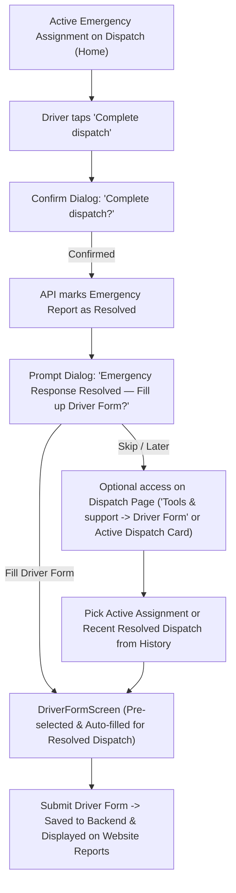

# Driver Form Redesign, Post-Resolution Workflow & Website Reports Separation Analysis

This document outlines the technical analysis and confirmed implementation plan for:
1. Replacing the old profile-editing **Driver Form** in `mdrrmo_flutter` (and its shared backend schema in `mdrrmo`) with the **Authorization** and **Fuel** sections.
2. Auto-filling fields (Trip Date, Assigned Driver, Government Vehicle, Authorized Passenger, Destination, Purpose, and Fuel totals).
3. Prompting the driver to fill out the **Driver Form** when an Emergency Response is resolved, while also providing an optional entry on the Dispatch Page (allowing drivers to select an active assignment or pick from recent resolved dispatches with auto-filled passenger inputs if they missed it).
4. Displaying the submitted **Driver Form** in the **Website Reports** while **strictly separating the Emergency Report (Incident/Clinical details) and the Driver Form (Authorization & Fuel details)**.

> [!IMPORTANT]
> All design questions have been confirmed and recorded in **Section 6** below. Let me know when you are ready for me to proceed with the code changes!

---

## 1. Current System Architecture

### 1.1 Mobile App: Tools & Support -> Driver Form (`mdrrmo_flutter`)
- **Current Screen**: [`DriverFormScreen`](file:///d:/Project/workspace_project/mdrrmo/mdrrmo_flutter/lib/screens/driver-responder/driver_form_screen.dart#L9-L101) opened from [`HomeScreen`](file:///d:/Project/workspace_project/mdrrmo/mdrrmo_flutter/lib/screens/driver-responder/home_screen.dart#L205-L219) under **Tools & support**.
- **Confirmed Change**: Remove the old Profile Name & Contact editing from `DriverFormScreen` and dedicate `DriverFormScreen` entirely to the **Authorization & Fuel** form linked to dispatches.

### 1.2 Mobile App: Emergency Response Resolution (`mdrrmo_flutter`)
- **Current Flow**: In [`HomeScreen._advance`](file:///d:/Project/workspace_project/mdrrmo/mdrrmo_flutter/lib/screens/driver-responder/home_screen.dart#L261-L294), when `assignment.step == 2` (`On scene`), tapping **Complete dispatch** asks for confirmation (`Complete dispatch?`), calls [`ResponderState.advanceAssignment()`](file:///d:/Project/workspace_project/mdrrmo/mdrrmo_flutter/lib/state/driver_responder_state.dart#L160-L219) (`PATCH /driver-responder/assignments/{report}/status` with `response_status: available`), transitions the report to `resolved`, and shows a snackbar.
- **Confirmed Change**: Immediately prompt the driver to fill out the **Driver Form** upon resolution (with an option to skip/fill later).

### 1.3 Website Reports (`mdrrmo`)
- **Admin Reports (`Admin/Reports/Index.tsx` & `Admin/Reports/Show.tsx`)**:
  - [`Admin/Reports/Index.tsx`](file:///d:/Project/workspace_project/mdrrmo/mdrrmo/resources/js/Pages/Admin/Reports/Index.tsx#L19-L80) lists all Emergency Reports.
  - [`Admin/Reports/Show.tsx`](file:///d:/Project/workspace_project/mdrrmo/mdrrmo/resources/js/Pages/Admin/Reports/Show.tsx#L56-L64) currently combines `driver_section` and `emergency_section` inside a single `<CardTitle>Patient care report</CardTitle>` card with only 4 driver fields (`driverName`, `governmentCardPlateNo`, `purpose`, `placeVisitedInspected`).
- **Dispatcher Reports (`Dispatcher/Reports/Index.tsx` & `Dispatcher/Reports/Show.tsx`)**:
  - [`Dispatcher/Reports/Index.tsx`](file:///d:/Project/workspace_project/mdrrmo/mdrrmo/resources/js/Pages/Dispatcher/Reports/Index.tsx#L16-L58) and [`Dispatcher/Reports/Show.tsx`](file:///d:/Project/workspace_project/mdrrmo/mdrrmo/resources/js/Pages/Dispatcher/Reports/Show.tsx#L15-L101) show the Emergency Report details (`form` is not loaded or displayed yet).
- **Driver / Responder Website (`Driver/Reports.tsx`)**:
  - [`Driver/Reports.tsx`](file:///d:/Project/workspace_project/mdrrmo/mdrrmo/resources/js/Pages/Driver/Reports.tsx#L32-L271) currently mixes `driver_section` and `emergency_section` inside a single modal dialog (`Driver trip & patient care report`) under a single list item button.

---

## 2. Requested Driver Form Specification

### Section 1: Authorization
| Field Label | JSON Key (`driver_section`) | Input Type | Auto-Fill Behavior |
| :--- | :--- | :--- | :--- |
| **Trip Date** | `tripDate` | Date (`YYYY-MM-DD`) | Auto-filled from the selected dispatch report date or current date (`DateTime.now()`) |
| **Assigned Driver** | `driverName` | Text (`max: 120`) | Auto-filled from `ResponderState.profile.name` (or active team's `driverName`) |
| **Government Vehicle** | `governmentCardPlateNo` | Select / Text (`max: 120`) | Auto-filled from active team ambulance (`plate_number · displayName`, e.g., `RESCUE 01 · Alpha Unit 1`) |
| **Authorized Passenger** | `authorizedPassenger` | Text (`max: 255`) | Auto-filled from the emergency report's **Patient / Reporter Name** (`victim_info['name']` / `reporter_name`) and accompanying **Team Responder** names |
| **Destination / Place to Visit** | `placeVisitedInspected` | Text (`max: 255`) | Auto-filled from dispatch trip destination or incident location |
| **Purpose of Trip** | `purpose` | Text (`max: 255`) | Auto-filled from emergency type (e.g., `Emergency Response - Medical`) |

### Section 2: Fuel
| Field Label | JSON Key (`driver_section`) | Input Type | Calculation / Behavior |
| :--- | :--- | :--- | :--- |
| **Balance in Tank (L)** | `balanceInTank` | Decimal numeric (`L`) | User input (e.g. `0.0`) |
| **Issued by Office (L)** | `issuedByOffice` | Decimal numeric (`L`) | User input (e.g. `0.0`) |
| **Purchased During Trip (L)** | `purchasedDuringTrip` | Decimal numeric (`L`) | User input (e.g. `0.0`) |
| **Total Available Fuel (L)** | `totalAvailableFuel` | Decimal numeric (`L`) | **Auto-calculated** (`Balance in Tank + Issued by Office + Purchased During Trip`) |
| **Fuel Used During Trip (L)** | `fuelUsedDuringTrip` | Decimal numeric (`L`) | User input (e.g. `0.0`) |
| **Remaining Fuel (L)** | `remainingFuel` | Decimal numeric (`L`) | **Auto-calculated** (`Total Available Fuel - Fuel Used During Trip`) |
| **Gear Oil Used (L)** | `gearOilUsed` | Decimal numeric (`L`) | User input (e.g. `0.0`) |

---

## 3. Mobile Workflow & Auto-Fill Integration (`mdrrmo_flutter`)

### 3.1 Post-Resolution Prompt
- When an Emergency Response is resolved (`HomeScreen._advance` at `step == 2`), after the status transitions to `resolved`:
  - Show a prompt dialog asking the driver to fill up the **Driver Form** now (with a `"Later"` option so it remains optional if they are busy).
  - Selecting **"Fill Driver Form"** opens `DriverFormScreen` pre-linked to that resolved emergency report with all **Authorization** fields (including **Trip Date**, **Assigned Driver**, **Government Vehicle**, **Authorized Passenger**, **Destination**, and **Purpose**) auto-filled.

### 3.2 Dispatch Page & Optional Entry (If Missed)
- **Dispatch Page (`HomeScreen`)**:
  - On active `ResponderAssignmentCard`: include an optional **"Driver Form"** button that opens `DriverFormScreen` for that assignment with **Authorized Passenger** (Patient/Reporter + Team Responders), **Trip Date**, **Assigned Driver**, **Government Vehicle**, **Destination**, and **Purpose** auto-filled.
  - Under **Tools & support -> Driver Form**: opens `DriverFormScreen` where the driver can pick from their **active assignment** or **recent resolved dispatches** (from History). Selecting a dispatch automatically fills in **Trip Date**, **Assigned Driver**, **Government Vehicle**, **Authorized Passenger**, **Destination / Place to Visit**, and **Purpose of Trip** (and loads any previously saved fuel/authorization values if editing).
- **History / Report Details (`RecordDetailsScreen`)**:
  - Separate buttons for **"Driver Form"** (Authorization + Fuel) and **"Patient-care form"** (Emergency/Clinical Report), plus a dedicated display section for the submitted **Driver Form** on the record details page.

---

## 4. Website Reports: Separation of Emergency Report & Driver Form (`mdrrmo`)

After submitting the Driver Form, the website reports will clearly **separate** the **Emergency Report** and the **Driver Form**:

### 4.1 Admin & Dispatcher Reports (`Admin/Reports/Index.tsx`, `Admin/Reports/Show.tsx`, `Dispatcher/Reports/Index.tsx`, `Dispatcher/Reports/Show.tsx`)
1. **Reports List / Tabs (`Index.tsx`)**:
   - Add a tab switcher at the top of the Reports page:
     - **Tab 1 — Emergency Reports**: Shows Incident Reference, Type, Location, Reported Date/Time, Priority, Status, and link to view the Emergency Report.
     - **Tab 2 — Driver Forms**: Lists dispatches with Driver Forms (showing Reference, Trip Date, Assigned Driver, Government Vehicle, Authorized Passenger, Destination, Purpose of Trip, and Fuel Used / Remaining Fuel, with a button to view the full Driver Form).
2. **Report Detail View (`Show.tsx`)**:
   - Separate the detail cards into distinct, dedicated sections instead of mixing them:
     - **Emergency Report Section**:
       - Incident Details Card (Location, Source, Reporter, Team, Driver, Description, Victim/Witness Info)
       - Location Map Card
       - Patient Care & Clinical Assessment Card (`emergency_section` only: Patient Name, Age/Sex, Incident Category, Time Reported/Arrival, Vital Signs, Allergies, Medications, Assessment, Treatment)
     - **Driver Form Section** (Dedicated card separated from Emergency Report):
       - **Authorization**: Trip Date, Assigned Driver, Government Vehicle, Authorized Passenger, Destination / Place to Visit, Purpose of Trip.
       - **Fuel**: Balance in Tank (L), Issued by Office (L), Purchased During Trip (L), Total Available Fuel (L), Fuel Used During Trip (L), Remaining Fuel (L), Gear Oil Used (L).

### 4.2 Driver / Responder Web Portal (`Driver/Reports.tsx`)
- Separate the page and modals into two independent workflows:
  1. **Driver Form (Authorization & Fuel)**: Separate button (`Fill Driver Form` / `Edit Driver Form`) and badge (`Driver Form saved` / `Driver Form pending`) opening a dedicated **Driver Form** modal with **Authorization** and **Fuel** sections, auto-fill for driver/vehicle/passenger/date/destination/purpose, and live calculation for `Total Available Fuel (L)` and `Remaining Fuel (L)`.
  2. **Emergency / Patient Care Report**: Separate button (`Fill Patient Care Form` / `Edit Patient Care Form`) and badge (`Patient Form saved` / `Patient Form pending`) opening the clinical **Emergency / Patient Care** modal (`emergency_section` only).

---

## 5. Backend & API Changes (`mdrrmo`)

1. **[`app/Http/Requests/SavePatientReportRequest.php`](file:///d:/Project/workspace_project/mdrrmo/mdrrmo/app/Http/Requests/SavePatientReportRequest.php)**:
   - Update `driver_section` validation rules to support all Authorization & Fuel fields:
     - `tripDate` (`nullable|string|max:40`)
     - `driverName` (`nullable|string|max:120`)
     - `governmentCardPlateNo` (`nullable|string|max:120`)
     - `authorizedPassenger` (`nullable|string|max:255`)
     - `placeVisitedInspected` (`nullable|string|max:255`)
     - `purpose` (`nullable|string|max:255`)
     - `passengerName` (`nullable|string|max:120`)
     - `balanceInTank` (`nullable|numeric|min:0|max:100000`)
     - `issuedByOffice` (`nullable|numeric|min:0|max:100000`)
     - `purchasedDuringTrip` (`nullable|numeric|min:0|max:100000`)
     - `totalAvailableFuel` (`nullable|numeric|min:0|max:100000`)
     - `fuelUsedDuringTrip` (`nullable|numeric|min:0|max:100000`)
     - `remainingFuel` (`nullable|numeric|min:-100000|max:100000`)
     - `gearOilUsed` (`nullable|numeric|min:0|max:100000`)
   - Allow `driver_section` and `emergency_section` to be submitted independently (`sometimes`/`nullable` at the top level as long as at least one section is provided) so submitting the **Driver Form** does not require or overwrite the clinical **Emergency Report** section.
2. **[`app/Http/Controllers/MobileRecordsController.php`](file:///d:/Project/workspace_project/mdrrmo/mdrrmo/app/Http/Controllers/MobileRecordsController.php) & [`app/Http/Controllers/Driver/DriverController.php`](file:///d:/Project/workspace_project/mdrrmo/mdrrmo/app/Http/Controllers/Driver/DriverController.php)**:
   - Merge existing `driver_section` / `emergency_section` when saving to `ReportForm` so partial updates from either form preserve the other section.
   - Return `patient` endpoint payload with auto-fill defaults (such as `driver_name`, `vehicle_plate`, `authorized_passenger` from `victim_info['name']` / `reporter_name` + team responders, `destination`, `purpose`, and `trip_date`).
3. **[`app/Http/Controllers/MobileDriverApiController.php`](file:///d:/Project/workspace_project/mdrrmo/mdrrmo/app/Http/Controllers/MobileDriverApiController.php)**:
   - Include `patient_name` / `authorized_passenger` (combining patient/reporter name and team responder names) and `has_driver_form` in assignment and history payloads so the Dispatch Page and `DriverFormScreen` can immediately auto-fill passenger inputs and indicate whether a dispatch already has a submitted Driver Form.
4. **[`app/Http/Controllers/Admin/EmergencyReportController.php`](file:///d:/Project/workspace_project/mdrrmo/mdrrmo/app/Http/Controllers/Admin/EmergencyReportController.php) & [`app/Http/Controllers/Dispatcher/ReportController.php`](file:///d:/Project/workspace_project/mdrrmo/mdrrmo/app/Http/Controllers/Dispatcher/ReportController.php)**:
   - Eager-load `form` (`ReportForm`) on both `index` and `show` endpoints so the website Reports pages can display the separated **Emergency Report** and **Driver Form** tabs and cards.

---

## 6. Confirmed Design Decisions

1. **Profile Name & Contact Editing**:
   - **Decision**: **Remove Profile & Contact Editing** from `DriverFormScreen`. `DriverFormScreen` is now dedicated exclusively to the **Driver Form (Authorization & Fuel)**.
2. **Standalone vs. Dispatch-Linked Submission**:
   - **Decision**: **Pick from recent resolved dispatches** (as well as any active assignment). When a driver opens **Tools & support -> Driver Form**, they can select from their active or recent resolved dispatches to fill out or update a missed Driver Form.
3. **Passenger Auto-Fill Source**:
   - **Decision**: **Auto-fill `Authorized Passenger`** using the **Patient / Reporter Name** from the emergency report along with accompanying **Team Responder** names.
4. **Website Reports Separation**:
   - **Decision**: After submitting the Driver Form, it appears in the Website Reports (`Admin`, `Dispatcher`, and `Driver` portals) with **Emergency Report** and **Driver Form** clearly separated in both list views and detail views.
