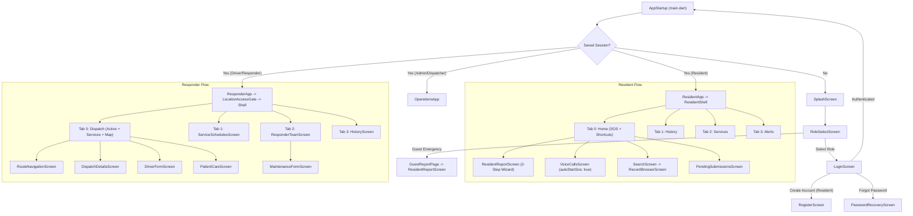

# HYOps / MDRRMO Flutter Mobile UI/UX Redesign Analysis & Specification

> **Status**: Phase 1 Analysis Completed (Pre-Implementation Baseline)  
> **Primary Brand Color**: Royal Blue (`#4169E1`)  
> **Project Root**: `mdrrmo_flutter/`

---

## 1. Project Overview and Application Purpose

**HYOps / MDRRMO (Balagtas Municipal Disaster Risk Reduction and Management Office)** is a mission-critical public safety, emergency dispatch, and community service mobile application built with Flutter. It connects municipal residents, field responders, ambulance drivers, and command center dispatchers in a unified operational platform.

### Core Capabilities
- **Emergency Incident Reporting**: Residents and unauthenticated guests can report emergencies (Medical, Fire, Vehicular Accident, Flood/Rescue, Trauma, General Emergency) with live GPS coordinates, interactive map pinning, incident descriptions, and contact information.
- **One-Tap SOS & Live Voice Dispatch**: Residents can initiate immediate Agora RTC voice calls (`VoiceCallsScreen(autoStartSos: true)`) with MDRRMO dispatchers, complete with call state tracking and invitation handling.
- **Field Responder & Driver Dispatch Operations**: Drivers and responders receive real-time emergency dispatches and scheduled municipal service assignments, navigate via turn-by-turn OSRM/OpenStreetMap routing (`RouteNavigationScreen`), progress dispatches through operational stages (`Start trip` → `Mark as on scene` → `Complete dispatch`), and file post-incident documentation.
- **Clinical, Logistics & Fleet Documentation**:
  - **Patient Care Report (`PatientCareScreen`)**: Confidential clinical record (vital signs, chief complaint, interventions, receiving hospital endorsement).
  - **Driver Trip & Fuel Log (`DriverFormScreen` / `StandaloneDriverFormScreen`)**: Trip authorization, odometer tracking, fuel balance calculation, and purchase requisitions.
  - **Vehicle Maintenance Reporting (`MaintenanceFormScreen`)**: Ambulance mechanical issue reporting and fleet availability warnings.
- **Community Service Requests (`ResidentScheduleScreen`)**: Non-emergency municipal assistance scheduling (medical transport, relief support, community assistance) with status tracking and cancellation workflows.
- **Offline / Unconfirmed Submission Queue (`PendingSubmissionsScreen`)**: Resilient local persistence (`SubmitQueue`) that stores timed-out or offline incident/service submissions for manual retry or removal.

---

## 2. Flutter Architecture and Folder Structure

The project follows a pragmatic, feature-and-role-layered Flutter architecture without heavy third-party state code-generation bloat.

```text
mdrrmo_flutter/
├── lib/
│   ├── main.dart                          # App entry point, AppStartup session restoration & routing
│   ├── app_prefs.dart                     # SharedPreferences wrapper for selected role persistence
│   ├── config/
│   │   ├── api_config.dart                # Dio HTTP client & environment base URL configuration
│   │   └── map_config.dart                # Balagtas bounds, default center, OSM tile & OSRM URLs
│   ├── data/
│   │   ├── models.dart                    # Core domain models (Session, RecordSummary, RecordDetail, etc.)
│   │   ├── resident_models.dart           # Resident-specific view models & mappers
│   │   ├── mdrrmo_api.dart                # Primary REST API client (auth, records, dispatches, forms, voice)
│   │   ├── auth_session_storage.dart      # Secure token & session persistence
│   │   ├── submit_queue.dart              # Local queue for unconfirmed/offline submissions
│   │   ├── driver_tracking.dart           # Live GPS tracking & background location publisher
│   │   ├── automatic_driver_tracking.dart # Lifecycle-bound automatic responder GPS reporting
│   │   ├── driver_realtime.dart           # Polling/real-time synchronization for responder state
│   │   ├── location_access.dart           # OS location permission & service checks
│   │   ├── location_service.dart          # Reverse geocoding & coordinate lookup
│   │   ├── routing_service.dart           # OSRM route geometry, steps, distance, and ETA calculation
│   │   └── voice_call_engine.dart         # Agora RTC voice call engine abstraction
│   ├── state/
│   │   ├── resident_state.dart            # ChangeNotifier + ResidentScope (InheritedNotifier)
│   │   └── driver_responder_state.dart    # ChangeNotifier + ResponderScope (InheritedNotifier)
│   ├── ui/
│   │   ├── app_theme.dart                 # Forui + Material theme definitions & semantic colors
│   │   ├── kit.dart                       # Shared UI primitives (AppScaffold, Surface, Pill, AppButton, etc.)
│   │   ├── form_page.dart                 # Shared form layout helpers (FormPage, FormSection, FormBanner)
│   │   ├── record_widgets.dart            # RecordListCard, RecordBadge, TimelineList
│   │   ├── page_loader.dart               # LoadingView & ErrorView states
│   │   ├── resilient_tiles.dart           # Resilient OpenStreetMap tile provider with error banner
│   │   ├── data_refresh.dart              # 30-second periodic & app-resume refresh wrapper
│   │   └── logout_action.dart             # Shared confirmation dialog for sign-out
│   ├── widgets/
│   │   └── res_widgets.dart               # MapCard & TimelineStep shared widgets
│   └── screens/
│       ├── splash_screen.dart             # Animated brand launch screen
│       ├── role_select_screen.dart        # Role selection & Guest Emergency Report entry
│       ├── login_screen.dart              # Role-contextual authentication screen
│       ├── register_screen.dart           # Resident registration + data privacy consent
│       ├── guest_report_screen.dart       # Unauthenticated emergency report wrapper
│       ├── account_screen.dart            # Account profile, password change & password recovery
│       ├── search_screen.dart             # Multi-scope record search launcher
│       ├── record_browser_screen.dart     # Paginated, filterable record explorer
│       ├── record_details_screen.dart     # Record details, ApiEditScreen, StandaloneDriverForm, PatientCare
│       ├── pending_submissions_screen.dart# Unconfirmed submission retry/delete queue
│       ├── responder_records_screen.dart  # Responder notifications & self-submitted reports
│       ├── route_navigation_screen.dart   # Live GPS map routing, step instructions & dispatch progression
│       ├── fleet_map_screen.dart          # Live ambulance & incident command map
│       ├── location_access_gate.dart      # Mandatory GPS permission gate for responders
│       ├── voice_calls_screen.dart        # SOS & dispatcher voice call console
│       ├── operations_app.dart            # Dispatcher/Admin command center & management suite
│       ├── resident/                      # Resident role module (shell, home, report, schedule, history, notifications)
│       └── driver-responder/              # Driver/Responder role module (shell, home, service, team, history, forms)
└── test/                                  # 24 comprehensive widget & integration test suites
```

---

## 3. Existing Screens and Their Responsibilities

| Screen / Widget | File Path | Primary Role(s) | Core Responsibility |
| :--- | :--- | :--- | :--- |
| `AppStartup` | `lib/main.dart` | All | Restores saved auth session, validates role compatibility, handles startup errors, routes to role shell. |
| `SplashScreen` | `lib/screens/splash_screen.dart` | All | Displays initial municipal rescue branding and loading progress before `RoleSelectScreen`. |
| `RoleSelectScreen` | `lib/screens/role_select_screen.dart` | Resident, Responder, Guest | Allows user to choose **Resident** or **Driver / Responder**, or launch **Report Emergency Now (Guest)**. |
| `LoginScreen` | `lib/screens/login_screen.dart` | All | Authenticates users; enforces role-lock validation; links to Resident registration and password recovery. |
| `RegisterScreen` | `lib/screens/register_screen.dart` | Resident | Multi-section registration form (Account, Personal, Address, Emergency Contact, Valid ID, Privacy Policy). |
| `GuestReportPage` | `lib/screens/guest_report_screen.dart` | Guest | Wraps `ResidentReportScreen` in guest mode with an anonymous API session. |
| `ResidentShell` | `lib/screens/resident/resident_shell.dart` | Resident | 4-tab bottom navigation (`Home`, `History`, `Services`, `Alerts`) + header actions & unapproved account banner. |
| `ResidentHomeScreen` | `lib/screens/resident/home_screen.dart` | Resident | Prominent SOS voice call button, quick actions (`Report an incident`, `Request a service`, `Search records`), active report & service summary, latest updates. |
| `ResidentReportScreen` | `lib/screens/resident/report_screen.dart` | Resident, Guest | 2-step emergency wizard (Step 1: Category selection; Step 2: GPS/Map pin, location, description, contact) + confirmation screen. |
| `ResidentHistoryScreen` | `lib/screens/resident/history_screen.dart` | Resident | Filterable list (`All reports`, `In progress`) of submitted emergency reports with detail sheet/navigation. |
| `ResidentScheduleScreen` | `lib/screens/resident/schedule_screen.dart` | Resident | Segmented view (`My requests`, `New request`) for viewing, creating, and cancelling municipal service requests. |
| `ResidentNotificationsScreen` | `lib/screens/resident/notifications_screen.dart` | Resident | Filterable (`All updates`, `Unread`) notification feed with unread badges and detail modal sheet. |
| `Shell` (Responder) | `lib/screens/driver-responder/shell.dart` | Driver, Responder | 4-tab bottom navigation (`Dispatch`, `Service`, `Team`, `History`), header shortcuts (Notifications, Submitted reports, Account, Logout), and active GPS tracking gate. |
| `HomeScreen` (Responder) | `lib/screens/driver-responder/home_screen.dart` | Driver, Responder | Displays active emergency dispatch (`ResponderAssignmentCard`), scheduled services (`HomeAssignmentsSection`), and nearby map (`Around you`). |
| `DispatchDetailsScreen` | `lib/screens/driver-responder/dispatch_details_screen.dart` | Driver, Responder | Comprehensive incident view with map preview, stage timeline, clinical/driver forms, and status progression CTA. |
| `DriverFormScreen` | `lib/screens/driver-responder/driver_form_screen.dart` | Driver, Responder | 2-step logistics form (Authorization & Fuel tank calculation) tied to an assignment. |
| `PatientCareScreen` | `lib/screens/record_details_screen.dart` | Driver, Responder | Confidential clinical record form (vitals, Glasgow Coma Scale, interventions, hospital endorsement). |
| `MaintenanceFormScreen` | `lib/screens/driver-responder/maintenance_form_screen.dart` | Driver | Ambulance maintenance/issue reporting form with severity and category selection. |
| `EmergencyFormScreen` | `lib/screens/driver-responder/emergency_form_screen.dart` | Driver, Responder | Field-initiated incident report form for responders on patrol. |
| `ServiceSchedulesScreen` | `lib/screens/driver-responder/service_schedules_screen.dart` | Driver, Responder | Lists all scheduled municipal service assignments with status progression and route navigation. |
| `ResponderTeamScreen` | `lib/screens/driver-responder/team_screen.dart` | Driver, Responder | Role toggle (`Driver` vs `Responder`), assigned ambulance switcher, maintenance banner, and team member directory with phone dialer. |
| `HistoryScreen` (Responder) | `lib/screens/driver-responder/history_screen.dart` | Driver, Responder | Filterable (`All`, `Completed`, `Invalid`) dispatch history with search and detail drawer. |
| `ResponderRecordsScreen` | `lib/screens/responder_records_screen.dart` | Driver, Responder | Dual-mode screen for Responder Notifications (`All updates`/`Unread`) and Responder-submitted reports. |
| `RouteNavigationScreen` | `lib/screens/route_navigation_screen.dart` | Driver, Responder | Full-screen interactive map with live GPS tracking, OSRM polyline route, turn-by-turn steps, destination confirmation, and stage progression actions. |
| `LocationAccessGate` | `lib/screens/location_access_gate.dart` | Driver, Responder | Enforces OS location service and permission compliance before allowing responder dispatch operations. |
| `VoiceCallsScreen` | `lib/screens/voice_calls_screen.dart` | All | Agora RTC voice call interface for SOS calls, dispatcher dialing, and incoming call invitations. |
| `AccountScreen` & `PasswordRecoveryScreen` | `lib/screens/account_screen.dart` | All | Displays user profile details, inline password update form, and unauthenticated password recovery flow. |
| `SearchScreen` | `lib/screens/search_screen.dart` | Resident, Staff | Launcher for searching all records, emergency reports, or service requests. |
| `RecordBrowserScreen` | `lib/screens/record_browser_screen.dart` | All | Searchable, filterable, paginated list of records with status, priority, category, and date range filters. |
| `RecordDetailsScreen` & `ApiEditScreen` | `lib/screens/record_details_screen.dart` | All | Full record metadata viewer, activity timeline, role-based action bar, and dynamic API form editor. |
| `PendingSubmissionsScreen` | `lib/screens/pending_submissions_screen.dart` | Resident, Responder | Displays queued unconfirmed reports/requests with retry (`Check & resend`) and delete controls. |
| `FleetMapScreen` | `lib/screens/fleet_map_screen.dart` | Staff / Admin | Command map showing live ambulance locations and active emergency markers. |
| `OperationsApp` | `lib/screens/operations_app.dart` | Admin / Dispatcher | Command center dashboard with live metrics, record management, fleet map, and team/shift/vehicle administration. |

---

## 4. Navigation Structure and User Flows



---

## 5. User Roles and Role-Specific Features

1. **Resident (`resident`)**:
   - Self-registration with valid ID upload/reference and privacy policy acceptance.
   - Account approval gating (`state.isApproved`): Unapproved accounts see an `"Account awaiting approval"` notice and have `"Report an incident"` disabled (`onTap: null`) until verified by MDRRMO staff, while retaining SOS voice call access.
   - 1-Tap SOS Voice Call (`resident-sos-button`), 2-step Emergency Incident Reporting, Community Service Request scheduling, Report History, Notifications, Record Search, and Unconfirmed Submission Queue.
2. **Driver / Responder (`driver`, `responder`)**:
   - Admin-provisioned accounts (self-signup disabled on `LoginScreen` when role is Driver/Responder).
   - Mandatory GPS location gate (`LocationAccessGate`) with continuous background/foreground telemetry.
   - Dynamic team role switching (`Driver` vs `Responder`) in `ResponderTeamScreen`, gated when active dispatches exist.
   - **Driver-exclusive features**: Ambulance assignment selection, `MaintenanceFormScreen` reporting, and primary dispatch progression (`Start trip` → `Mark as on scene` → `Complete dispatch`) on the Home screen.
   - **Shared Responder/Driver features**: `DriverFormScreen` (Trip & Fuel log), `PatientCareScreen` (Clinical care record), `RouteNavigationScreen` (turn-by-turn navigation & pin confirmation), `ServiceSchedulesScreen`, `HistoryScreen`, and `ResponderRecordsScreen`.
3. **Guest (`guest`)**:
   - Immediate unauthenticated access to `GuestReportPage` (`ResidentReportScreen` with `guestApi`) from `RoleSelectScreen` with a clear informational banner explaining guest mode limitations.
4. **Dispatcher / Admin (`admin`, `dispatcher` via `OperationsApp`)**:
   - Operational summary metrics (`Pending reports`, `Automatic dispatch`), full record browser across all entities (Emergencies, Dispatches, Services, Driver forms, Patient care, Accounts, Teams, Shifts, Vehicles, Maintenance), live `FleetMapScreen`, and `ApiEditScreen` for administrative CRUD.

---

## 6. Current Design System and Theme Analysis

### Current Implementation (`lib/ui/app_theme.dart` & `lib/ui/kit.dart`)
- **Hybrid Framework Setup**: Uses `forui` (`FTheme`, `FScaffold`, `FHeader`, `FButton`, `FTextFormField`, `FSelect`, `FDialog`) wrapped inside Material (`theme.toApproximateMaterialTheme()`).
- **Incomplete Material Theme Bridging**: `AppTheme._build` only overrides `colors.primary` (`#4169E1`) and `colors.primaryForeground` (`#FFFFFF`) on `FThemeData`, then calls `theme.toApproximateMaterialTheme()` in `main.dart`, `resident_app.dart`, and `responder_app.dart` **without customizing Material component themes** (`InputDecorationTheme`, `FilledButtonTheme`, `OutlinedButtonTheme`, `ChipTheme`, `CardTheme`, `NavigationBarTheme`, `DividerTheme`, `DialogTheme`, `BottomSheetTheme`).
- **Scattered Hardcoded Colors**:
  - `lib/screens/driver-responder/responder_widgets.dart`: Hardcodes `Color(0xFF2563EB)`, `Color(0xFF0F766E)`, `Color(0xFFD97706)`, `Color(0xFFDC2626)`, `Color(0xFF64748B)`.
  - `lib/screens/resident/resident_widgets.dart`: Hardcodes `Color(0xFF2563EB)` for info statuses instead of Royal Blue or centralized tokens.
  - `lib/ui/resilient_tiles.dart`: Hardcodes `Colors.white.withValues(alpha: 0.92)` and `Colors.black87`, which breaks dark mode contrast.
  - `lib/screens/route_navigation_screen.dart` & `lib/screens/fleet_map_screen.dart`: Hardcodes `Colors.blue`, `Colors.red`, `Colors.green`, `Colors.orange`.

---

## 7. Existing Reusable Widgets

| Widget | Location | Assessment & Action Plan |
| :--- | :--- | :--- |
| `AppScaffold` | `lib/ui/kit.dart` | Good foundation bridging `FScaffold` + `Material`, but header action spacing and bottom bar dividers need refinement. |
| `Surface` | `lib/ui/kit.dart` | Clean bordered container, currently uses `radius: 16`. Will standardize with `AppRadius` tokens and crisp 1px borders. |
| `ResidentPanel` / `ResponderPanel` | `resident_widgets.dart` / `responder_widgets.dart` | Duplicate wrappers around `Surface` with oversized `radius: 20` and `padding: 20`. Will refine to use restrained radii (`12–14px`) and balanced padding (`16px`) to eliminate "AI slop" bubbly cards and preserve horizontal space on 320px screens. |
| `Pill` / `RecordBadge` / `ResponderTag` | `kit.dart` / `record_widgets.dart` / `responder_widgets.dart` | Three separate status badge implementations. Will unify their visual geometry (compact padding, crisp 1px border tint, high-contrast semantic text) while keeping their class signatures intact. |
| `AppButton` | `lib/ui/kit.dart` | Wraps `FButton`; needs consistent height, icon alignment, and clear visual hierarchy between primary (`#4169E1`), secondary, outline, ghost, and destructive (`Semantic.danger`) states. |
| `TextInput` / `SelectInput` | `lib/ui/kit.dart` | Wraps `FTextFormField` and `FSelect`; needs clearer label hierarchy and consistent spacing. |
| `FormPage` / `FormSection` / `FormBanner` | `lib/ui/form_page.dart` | Solid structure for responder forms; will refine typography, section header accents, and sticky bottom bar styling. |
| `RecordListCard` & `TimelineList` | `lib/ui/record_widgets.dart` | Used across record browser and details; needs cleaner metadata grid alignment and timeline connector polish. |
| `LoadingView` & `ErrorView` | `lib/ui/page_loader.dart` | Currently uses a bare `CircularProgressIndicator` or centered icon; will upgrade to structured, reassuring public-safety loading/error cards while preserving text contracts. |
| `MapCard` & `TimelineStep` | `lib/widgets/res_widgets.dart` | Shared map container and step timeline; will improve map frame border, header bar, and step indicator contrast. |

---

## 8. UI/UX Problems and Inconsistencies

1. **Unfinished / Raw Utility Screens**:
   - **`AccountScreen` & `PasswordRecoveryScreen` (`lib/screens/account_screen.dart`)**: Uses raw unstyled `Text`, default `TextField`s without borders, plain `TextButton`s, and a bare `Divider` inside a flat `ListView`. Looks like an unstyled debug screen.
   - **`PendingSubmissionsScreen` (`lib/screens/pending_submissions_screen.dart`)**: Uses `FScaffold` directly without `AppScaffold` Material ancestry, unpadded top `Text`, and raw inline error text.
   - **`SearchScreen` (`lib/screens/search_screen.dart`)**: Renders 3 full-width primary buttons stacked in a `ListView` with zero context, descriptions, or category icons.
   - **`RecordBrowserScreen` (`lib/screens/record_browser_screen.dart`)**: Uses raw `TextField`, unaligned `TextButton` date pickers, raw `DropdownButtonFormField`s, and plain text empty/error messages.
   - **`ApiEditScreen` (`lib/screens/record_details_screen.dart`)**: Renders raw `TextFormField`s and `DropdownButtonFormField`s directly in a `ListView` with no section framing or sticky action bar.
   - **`OperationsApp` (`lib/screens/operations_app.dart`)**: Displays raw key-value `Text` lines (`Pending reports: 3`) and a wall of 12+ identical primary `AppButton`s with no visual grouping between Dispatch Operations, Clinical/Field Logs, and System Administration.
   - **`VoiceCallsScreen` (`lib/screens/voice_calls_screen.dart`)**: Uses unstyled default Material `Card` and `ListTile` widgets instead of a dedicated emergency communications console layout.
   - **`GuestReportPage` (`lib/screens/guest_report_screen.dart`)**: Uses a default Material `Scaffold` + `AppBar` instead of `AppScaffold` + `pushedHeader`, causing a jarring header transition from `RoleSelectScreen`.
2. **Excessive Card Nesting ("Card-in-Card" Clutter)**:
   - In `HomeAssignmentsSection` (`lib/screens/driver-responder/home_assignments_section.dart`), a `ResponderPanel` (`ValueKey('home-assignments-container')`, 20px padding + border) wraps `ResponderAssignmentCard` (which is itself a `ResponderPanel` with 20px padding + border) and `ServiceScheduleCard` (another bordered card). On a 320px screen, double borders and 40px+ of combined horizontal padding crush the inner content width to ~208px!
3. **Inconsistent Button & Chip Styling**:
   - Screens mix `AppButton` (Forui `FButton`), Material `FilledButton`, `OutlinedButton`, `TextButton`, `ChoiceChip`, and `FilterChip`. Because Material component themes are not configured in `AppTheme`, Material buttons and chips fall back to default M3 purple/slate styling or uncoordinated shapes instead of cohesive Royal Blue (`#4169E1`) tokens.

---

## 9. Usability and Accessibility Issues

1. **Contrast & Color Semantics**:
   - Secondary/muted text in several dark and light surfaces uses low-opacity alpha blends that dip below WCAG AA (4.5:1) contrast on tinted backgrounds.
   - Emergency actions (SOS button, critical severity tags, destructive confirmations) and standard primary actions (`#4169E1` Royal Blue) need strict visual separation so responders and distressed residents can immediately distinguish life-safety controls from routine navigation.
2. **Touch Target Density & Ergonomics**:
   - Date filter buttons in `RecordBrowserScreen` and inline text actions in `AccountScreen` have small hit areas (< 44px height).
   - Field responders operating in moving ambulances need clear, full-width primary stage progression buttons (`Start trip`, `Mark as on scene`, `Complete dispatch`) with unambiguous icon + label hierarchy.
3. **Form Usability**:
   - `RegisterScreen` has 6 distinct logical groups (Account Credentials, Personal Details, Residential Address, Emergency Contact, Valid ID, Privacy Consent) rendered in one long scroll without clear step/section numbering or visual rhythm.
   - `DriverFormScreen`, `PatientCareScreen`, and `MaintenanceFormScreen` benefit from clearer required-field indicators and structured field groupings.

---

## 10. Responsive Layout Issues

- **Narrow Viewport (320px width) + Large Text Scale (1.4x–1.5x)**:
  - The test suite explicitly tests `Size(320, 640)` and `Size(320, 760)` with `TextScaler.linear(1.4)` and `TextScaler.linear(1.5)`.
  - Nested cards with 20px padding at each level leave insufficient horizontal room for side-by-side `Row` elements, causing text wrapping or potential overflows if padding is not kept compact (`12–16px`).
  - Header subtitles and badge rows must always use `Wrap` or `Expanded`/`Flexible` with `TextOverflow.ellipsis` where appropriate.

---

## 11. Existing Functionality That Must Be Preserved

All business logic, state management, API integrations, and widget test contracts across all 24 test files in `test/` **must remain 100% intact**:

### Critical Widget Keys & Types Checked by Automated Tests
- `ValueKey('resident-sos-button')`: Must remain a `FilledButton` with `CircleBorder` shape, positioned vertically above `'Report an incident'` on `ResidentHomeScreen`.
- `ValueKey('responder-home-list')`: Main scrollable `ListView` on Responder `HomeScreen`.
- `ValueKey('home-assignments-container')`: Container widget in `HomeAssignmentsSection`.
- `NavigationDestination`: 4 tabs in `ResidentShell` (`Home`, `History`, `Services`, `Alerts`) and 4 tabs in Responder `Shell` (`Dispatch`, `Service`, `Team`, `History`).
- `ResidentShortcut`: Used on `ResidentHomeScreen` with `title: 'Report an incident'` (`onTap: null` when `!state.isApproved`).
- `ChoiceChip`: Used in `ResidentHistoryScreen` (`'All reports'`, `'In progress'`), `ResidentNotificationsScreen` (`'All updates'`, `'Unread'`), `ResidentScheduleScreen` (`'My requests'`, `'New request'`), and `ResponderRecordsScreen` (`'All updates'`, `'Unread'`).
- `FilterChip`: Used in Responder `HistoryScreen` (`'All'`, `'Completed'`, `'Invalid'`).
- `SwitchListTile`: Used in `ResponderTeamScreen` for Driver/Responder role switching.
- `OutlinedButton`: Used for `'Use my current location'` in `ResidentReportScreen`, and `'Navigate'` / `'View report'` in `ResponderAssignmentCard`.
- `FilledButton`: Used for `'Continue to sign in'` in `RoleSelectScreen`, `'Send service request'` in `ResidentScheduleScreen`, and `'Start trip'` / `'Mark as on scene'` / `'Complete dispatch'` in `ResponderAssignmentCard`.
- `TextFormField` & `DropdownButtonFormField<String>`: Used in `ApiEditScreen`.
- `TextField`: Used in `RecordBrowserScreen` (`'Search all records'`).

---

## 12. Proposed New Design Direction

### Aesthetic Philosophy: High-Trust Municipal Public Safety ("Zero AI Slop")
- **Authoritative & Calm Under Pressure**: Designed like a production-grade civic emergency & fleet dispatch platform (inspired by modern CAD mobile terminals and clinical field apps).
- **Restrained Geometry**:
  - Replace exaggerated 20–24px bubbly cards with crisp **12px** standard container radii (`AppRadius.md`), **8px** input/button/badge radii (`AppRadius.sm`), and **1px** structural borders (`#E2E8F0` in light mode, `#1E293B` in dark mode).
  - Eliminate nested bordered cards (`Card`-inside-`Card`). When a section groups multiple items (such as `HomeAssignmentsSection`), use a clean section header and flat or single-level cards.
- **No Unnecessary Gradients or Glows**: Use solid, high-contrast surfaces (`#F8FAFC` app background, `#FFFFFF` elevated card surface, `#F1F5F9` subtle muted surface in light mode; `#0B1120` background, `#111827` surface, `#1E293B` muted surface in dark mode).
- **Clear Operational Hierarchy**:
  - **Primary Brand & Interactive State**: Royal Blue (`#4169E1`) for primary CTAs, active navigation indicators, focused inputs, selected chips, and route polylines.
  - **Life-Safety / Emergency State**: Crimson Red (`#E11D48` / `#DC2626`) strictly reserved for the Resident SOS Call button, critical emergency badges, and destructive actions.
  - **Operational Progression States**: Amber (`#D97706`) for pending/en-route/awaiting verification; Emerald (`#16A34A`) for on-scene/completed/approved/online telemetry.

---

## 13. Proposed Component Architecture

All design tokens and reusable components will be centralized in `lib/ui/`:

1. **`lib/ui/app_theme.dart`**:
   - `AppColors`: Centralized color tokens for Royal Blue brand palette, neutral slate surfaces, text hierarchy, borders, and semantic status colors (`Semantic.danger`, `Semantic.warning`, `Semantic.success`, `Semantic.info`, `Semantic.neutral`).
   - `AppSpacing`: Standardized 4pt grid tokens (`xs: 4`, `sm: 8`, `md: 12`, `lg: 16`, `xl: 20`, `xxl: 24`, `xxxl: 32`).
   - `AppRadius`: Restrained border radius scale (`xs: 6`, `sm: 8`, `md: 12`, `lg: 14`, `pill: 999`).
   - `AppTheme`: Configures both `FThemeData` (Forui) and a complete `ThemeData` (Material 3) via `AppTheme.materialLight()` / `AppTheme.materialDark()` extension on `FThemeData.toApproximateMaterialTheme()`, styling `FilledButton`, `OutlinedButton`, `TextButton`, `InputDecoration`, `Chip`, `Card`, `NavigationBar`, `Divider`, `Dialog`, and `BottomSheet` consistently around Royal Blue (`#4169E1`).
2. **`lib/ui/kit.dart`**:
   - `AppType`: Refined typographic scale with tabular figures for operational metrics, timestamps, and coordinates.
   - `AppScaffold`, `pushedHeader`, `rootHeader`, `HeaderIconButton`: Crisp top app bar with clear bottom border, safe area handling, and consistent action button sizing.
   - `Surface`: Primary card container with 12px radius, 1px structural border, and optional subtle accent stripe or tint.
   - `SectionHeader`: Standardized section title + optional trailing action/badge.
   - `Pill`: High-contrast status badge with semantic background tint, border, and optional leading dot/icon.
   - `AppButton`, `TextInput`, `SelectInput`, `Sheet`, `confirmDialog`: Unified interactive controls.

---

## 14. Royal Blue Color System

| Token Role | Light Mode Hex | Dark Mode Hex | Usage & Contrast Rules |
| :--- | :--- | :--- | :--- |
| **Primary (Royal Blue)** | `#4169E1` | `#4169E1` | Primary buttons, active navigation indicators, focused input borders, selected filter chips, brand accents. |
| **Primary Pressed / Strong** | `#3154B6` | `#5B82F3` | Pressed/hover interactive states and high-emphasis links. |
| **Primary Container / Soft** | `#EEF2FF` | `#1E294B` | Active navigation pill background, subtle brand callout surfaces, icon badge backgrounds. |
| **On Primary** | `#FFFFFF` | `#FFFFFF` | Text and icons placed directly on `#4169E1` (WCAG AA compliant). |
| **On Primary Container** | `#1E3A8A` | `#DBEAFE` | Text and icons placed on `Primary Container` surfaces. |
| **Background** | `#F8FAFC` | `#0B1120` | Root scaffold background (cool slate-tinted off-white / deep navy-slate). |
| **Surface (Card)** | `#FFFFFF` | `#111827` | Standard card, sheet, dialog, and navigation bar surface. |
| **Surface Muted / Secondary** | `#F1F5F9` | `#1E293B` | Secondary containers, input backgrounds, metric tiles, unselected chip fills. |
| **Foreground (Primary Text)** | `#0F172A` | `#F8FAFC` | Headings, body text, form values, record titles (>15:1 contrast). |
| **Muted Foreground** | `#475569` | `#94A3B8` | Subtitles, metadata labels, helper text, timestamps (≥4.6:1 contrast). |
| **Border / Divider** | `#E2E8F0` | `#1E293B` | Card outlines, section dividers, input borders. |
| **Emergency / Danger** | `#DC2626` | `#F87171` | SOS Call button (`#DC2626`), critical priority badges, error banners, destructive actions. |
| **Warning / En Route** | `#D97706` | `#FBBF24` | Pending verification, en-route status, maintenance warnings, offline queue alerts. |
| **Success / On Scene** | `#15803D` | `#4ADE80` | Completed dispatches, approved accounts, active GPS telemetry, resolved status. |
| **Info / Dispatched** | `#1D4ED8` | `#60A5FA` | Informational notices, newly dispatched status, secondary operational badges. |

---

## 15. Screen-by-Screen Redesign Plan

1. **Splash, Role Selection & Auth (`splash_screen.dart`, `role_select_screen.dart`, `login_screen.dart`, `register_screen.dart`, `guest_report_screen.dart`, `main.dart`)**:
   - Upgrade `SplashScreen` with a structured municipal crest badge, Royal Blue accent bar, and crisp typography.
   - Refine `RoleSelectScreen` role selection cards with clear selection indicators (radio/check badge, Royal Blue border when selected) and a distinct emergency callout bar for `"Report Emergency Now (Guest)"`.
   - Polish `LoginScreen` with a role context pill, clean input grouping, and clear secondary actions.
   - Organize `RegisterScreen` into clearly numbered, scannable sections with a structured privacy policy card.
   - Update `GuestReportPage` to use `AppScaffold` + `pushedHeader` for seamless visual continuity.
2. **Resident Experience (`resident_shell.dart`, `resident_widgets.dart`, `home_screen.dart`, `report_screen.dart`, `schedule_screen.dart`, `history_screen.dart`, `notifications_screen.dart`)**:
   - **Resident Home**: Frame the circular `resident-sos-button` (`FilledButton` with `CircleBorder`) inside a high-clarity Emergency SOS Command Banner above the 2x2/list quick action shortcuts (`Report an incident`, `Request a service`, `Search records`), followed by clean status cards for active reports/requests and recent updates.
   - **Resident Report Wizard**: Add a clear 2-step progress indicator bar, structured incident category tiles in Step 1, and a clean map + coordinate readout + contact form in Step 2, plus a reassuring confirmation screen.
   - **Resident Services, History & Notifications**: Style `ChoiceChip` filter bars with Royal Blue active states, refine list card metadata layout, and polish detail bottom sheets.
3. **Driver & Responder Experience (`shell.dart`, `responder_widgets.dart`, `home_screen.dart`, `home_assignments_section.dart`, `service_schedule_card.dart`, `service_schedules_screen.dart`, `team_screen.dart`, `history_screen.dart`, `dispatch_details_screen.dart`)**:
   - **Eliminate Double-Nested Cards**: In `HomeAssignmentsSection`, make `home-assignments-container` a clean section wrapper without redundant outer card padding/borders so `ResponderAssignmentCard` and `ServiceScheduleCard` have maximum horizontal breathing room on 320px screens.
   - **Responder Assignment Card**: Highlight incident ID, priority badge, category, address, and a clear stage progress bar, with prominent `FilledButton` primary stage action (`Start trip` / `Mark as on scene` / `Complete dispatch`) and `OutlinedButton` secondary actions (`Navigate`, `View report`).
   - **Responder Team Screen**: Cleanly structure the Driver/Responder `SwitchListTile`, Assigned Ambulance card (`ASSIGNED AMBULANCE`, `Plate No: ...`, `Report maintenance`), and team roster with one-tap call buttons.
   - **Responder Forms (`driver_form_screen.dart`, `emergency_form_screen.dart`, `maintenance_form_screen.dart`, `PatientCareScreen`)**: Standardize step indicators, clinical/fuel field grids, and confirmation states.
4. **Shared Navigation, Voice, Records & Operations (`route_navigation_screen.dart`, `location_access_gate.dart`, `voice_calls_screen.dart`, `account_screen.dart`, `pending_submissions_screen.dart`, `search_screen.dart`, `record_browser_screen.dart`, `record_details_screen.dart`, `responder_records_screen.dart`, `fleet_map_screen.dart`, `operations_app.dart`)**:
   - **Route Navigation & Fleet Map**: Crisp HUD telemetry cards for distance/ETA, expandable turn-by-turn directions, and high-visibility map markers.
   - **Voice Calls Console**: Redesign `VoiceCallsScreen` with a dedicated live-call status card, pulsing/clear call state indicator, and structured invitation list.
   - **Account & Password Recovery**: Replace raw text and borderless inputs with structured profile metadata cards and framed security forms.
   - **Search, Record Browser & Record Details (`ApiEditScreen`)**: Frame search scopes with descriptive cards on `SearchScreen`, organize filter controls on `RecordBrowserScreen`, and wrap `ApiEditScreen` fields in a clean `Surface` card with a sticky save bar.
   - **Operations Center (`OperationsApp`)**: Group metrics into a structured KPI grid and organize the 12+ management modules into logical operational categories while preserving every button label and detail view.

---

## 16. Implementation Phases and Priorities

- [x] **Phase 1: Project Discovery & Analysis Documentation** (`docs/UI_UX_REDESIGN_ANALYSIS.md`)
- [x] **Phase 2: Royal Blue Theme & Design System Foundation** (`lib/ui/app_theme.dart`, `lib/ui/kit.dart`, `lib/ui/form_page.dart`, `lib/ui/record_widgets.dart`, `lib/ui/page_loader.dart`, `lib/ui/resilient_tiles.dart`, `lib/widgets/res_widgets.dart`)
- [x] **Phase 3: Auth, Onboarding & Guest Flow Redesign** (`lib/main.dart`, `lib/screens/splash_screen.dart`, `lib/screens/role_select_screen.dart`, `lib/screens/login_screen.dart`, `lib/screens/register_screen.dart`, `lib/screens/guest_report_screen.dart`)
- [x] **Phase 4: Resident Module Redesign** (`lib/screens/resident/*`)
- [x] **Phase 5: Driver & Responder Module Redesign** (`lib/screens/driver-responder/*`)
- [x] **Phase 6: Shared Screens, Voice, Maps, Records & Operations Redesign** (`lib/screens/account_screen.dart`, `lib/screens/pending_submissions_screen.dart`, `lib/screens/search_screen.dart`, `lib/screens/record_browser_screen.dart`, `lib/screens/record_details_screen.dart`, `lib/screens/responder_records_screen.dart`, `lib/screens/voice_calls_screen.dart`, `lib/screens/route_navigation_screen.dart`, `lib/screens/location_access_gate.dart`, `lib/screens/fleet_map_screen.dart`, `lib/screens/operations_app.dart`)
- [x] **Phase 7: Static Analysis, Widget Test Verification & Documentation Update** (`flutter analyze`, `flutter test`)

---

## 17. Potential Risks and Regression Considerations

1. **Widget Test Selector Regressions**:
   - *Risk*: Changing a `FilledButton` to an `AppButton` (or vice versa), removing a `ValueKey`, or altering capitalization of labels like `'Use my current location'` or `'Continue to sign in'` will break existing widget tests.
   - *Mitigation*: Strictly preserve all widget types, keys, and text labels audited in Section 11 while styling them through `AppTheme` and layout composition.
2. **Small-Screen (320px) + High Text-Scale (1.5x) Layout Overflows**:
   - *Risk*: Adding decorative icons or excessive padding inside `Row` widgets can trigger `RenderFlex overflowed` errors during `resident_ui_test.dart` and `responder_ui_test.dart`.
   - *Mitigation*: Eliminate nested card padding, use `Wrap` or `Flexible`/`Expanded` inside rows, and verify with `flutter test`.
3. **Material / Forui Theme Ancestor Conflicts**:
   - *Risk*: Using Material widgets (`ChoiceChip`, `FilterChip`, `SwitchListTile`, `TextField`, `DropdownButtonFormField`) without a `Material` ancestor or proper `ThemeData` causes visual glitches or runtime exceptions.
   - *Mitigation*: Ensure `AppScaffold` always provides a `Material` ancestor and `AppTheme` configures all Material 3 sub-themes on `.toApproximateMaterialTheme()`.

---

## 18. Acceptance Criteria and Testing Strategy

- **Visual & Brand Compliance**:
  - Royal Blue (`#4169E1`) is consistently applied as the primary brand color across light and dark themes.
  - Emergency/SOS actions (`#DC2626`) remain visually distinct from standard Royal Blue primary actions.
  - Zero "AI slop" (no excessive rounded cards, no card-in-card nesting bloat, no random gradients or glowing shadows).
- **Completeness**:
  - Every screen in the project (including previously raw screens like `AccountScreen`, `PendingSubmissionsScreen`, `SearchScreen`, `RecordBrowserScreen`, `ApiEditScreen`, `VoiceCallsScreen`, and `OperationsApp`) is cohesive and production-ready.
- **Automated Verification**:
  - `flutter analyze` passes with **0 errors and 0 warnings**.
  - `flutter test` passes **100% of existing widget and unit test suites**, including 320px narrow-screen and 1.4x/1.5x text-scale accessibility tests.

---

## 19. Implementation Summary & Final Verification Results

### Completed Design System & Architectural Improvements
1. **Centralized Royal Blue (`#4169E1`) Theme & Tokens (`lib/ui/app_theme.dart`, `lib/ui/kit.dart`)**:
   - Implemented `AppColors` with Royal Blue (`#4169E1`), pressed/strong (`#3154B6`), light/dark slate neutrals, semantic status colors (`danger`, `warning`, `success`, `info`, `neutral`), and soft container/border tokens.
   - Added `AppSpacing` (4pt scale) and `AppRadius` (`xs: 6`, `sm: 8`, `md: 12`, `lg: 14`, `pill: 999`), replacing excessive `18px–22px` card radii across the app.
   - Built `AppTheme.materialLight` and `AppTheme.materialDark` (`buildMaterialTheme`) to bridge Forui (`FThemeData`) with Material 3 sub-themes (`CardTheme`, `FilledButtonTheme`, `OutlinedButtonTheme`, `TextButtonTheme`, `InputDecorationTheme`, `ChipTheme`, `NavigationBarTheme`, `BottomSheetTheme`, `DialogTheme`, `SnackBarTheme`, `SwitchTheme`, `CheckboxTheme`).
2. **Eliminated Double-Nested Cards & Layout Bloat**:
   - Converted `home-assignments-container` in `lib/screens/driver-responder/home_assignments_section.dart` from a padded, bordered `ResponderPanel` into a zero-chrome `Column(key: ValueKey('home-assignments-container'))`, restoring 36px of horizontal width to `ResponderAssignmentCard` and `ServiceScheduleCard` on 320px screens.
   - Standardized `Surface`, `ResidentPanel`, and `ResponderPanel` to use crisp 1px borders (`AppRadius.md` = 12px) and zero elevation shadows.
3. **Full Screen-by-Screen Redesign**:
   - **Startup, Onboarding & Auth**: Redesigned `SplashScreen`, `RoleSelectScreen`, `LoginScreen`, `RegisterScreen`, and `GuestReportPage` (`AppScaffold` + `pushedHeader`).
   - **Resident Experience**: Redesigned `ResidentShell` (with `LogoMark`, top-bordered `NavigationBar`, and styled bottom sheet), `ResidentHomeScreen` (framed circular `resident-sos-button` inside a dedicated emergency callout banner), `ReportScreen` (Step 1–3 wizard and confirmation card), `ScheduleScreen`, `HistoryScreen`, and `NotificationsScreen`.
   - **Driver / Responder Experience**: Redesigned `DriverResponderShell`, `HomeScreen` (response desk header, `ResponderAssignmentCard` with framed location box, `_MapHero`, `_ConnectionCard`), `ServiceScheduleCard`, `ServiceSchedulesScreen`, `TeamScreen` (Driver/Responder `SwitchListTile`, ambulance card, maintenance warning, team directory), `HistoryScreen`, `EmergencyFormScreen`, `MaintenanceFormScreen`, and `DispatchDetailsScreen`.
   - **Shared, Voice, Maps, Records & Operations**: Redesigned `AccountScreen`, `PasswordRecoveryScreen`, `PendingSubmissionsScreen` (migrated from `FScaffold` to `AppScaffold`), `SearchScreen`, `RecordBrowserScreen`, `ResponderRecordsScreen`, `LocationAccessGate`, `VoiceCallsScreen`, `RouteNavigationScreen`, `FleetMapScreen`, `OperationsApp`, `OperationsDetails`, and `RecordDetailsScreen` (`ApiEditScreen`).

### Final Verification Results
- **`flutter analyze`**: **0 issues found** (`No issues found!`).
- **`flutter test`**: **132 / 132 tests passed** (`00:37 +132: All tests passed!`), including all narrow-viewport (`320x568` at `1.4x` and `1.5x` text scale) and role workflow tests.
- **Outstanding Issues**: None. All acceptance criteria have been met.
